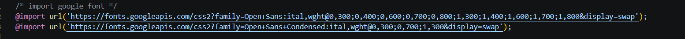
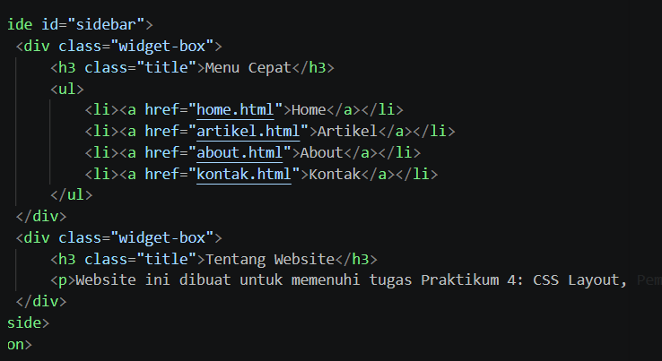
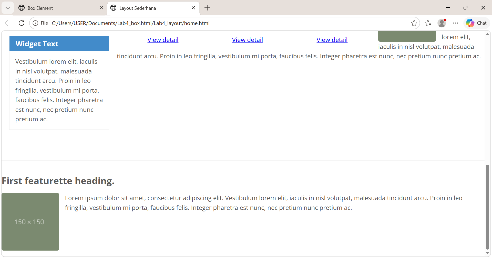

# Lab4— Praktikum 4: CSS Layout

Mata Kuliah: Pemrograman Web Nama: Alfi IFtihal Nurul Afiat NIM: 312510041 Kelas: I251D Program Studi: Teknik Informatika, Universitas Pelita Bangsa

# Tujuan Praktikum
Memahami struktur dasar pembuatan layout.
Memahami konsep box element.
Memahami CSS Floating.
Memahami HTML5 Semantic Element.
Membuat layout web sederhana.
# Struktur Folder
````
Lab4Web/
├── README.md
├── screenshots/
├── lab4_box/
│   └── lab4_box.html
└── lab4_layout/
    ├── home.html
    ├── about.html
    ├── kontak.html
    └── style.css
````
# Bagian 1 — Box Element dan CSS Float (```lab4_box/lab4_box.html```)
## 1.1 Membuat dokumen HTML dasar
Dibuat file lab4_box.html berisi kerangka HTML5 (````DOCTYPE, html, head, body````) dengan ````<header>```` yang berisi judul ````<h1>Box Element</h1>````. Tag ````meta viewport```` ditambahkan agar halaman menyesuaikan lebar layar perangkat.

## 1.2 Membuat box element
Di dalam ````<section>```` ditambahkan tiga tag ````div```` dengan class ````div1````, ````div2````, dan ````div3````. Semua elemen HTML pada dasarnya adalah sebuah kotak (box) yang terdiri dari margin, border, padding, dan content. Tanpa float, ````div```` bersifat block sehingga setiap ````div```` menempati satu baris penuh dan tersusun ke bawah.
````
html
<section>
    <div class="div1">Div 1</div>
    <div class="div2">Div 2</div>
    <div class="div3">Div 3</div>
</section>
````
## 1.3 CSS Float

Pada ````<style>```` ditambahkan ````float: left```` untuk semua ````div````, serta ````padding:10px```` dan warna latar berbeda untuk tiap class.
css
````
div {
    float: left;
    padding: 10px;
}
.div1 { background: red; }
.div2 { background: yellow; }
.div3 { background: green; }
````
Dengan ````float: left````, elemen "mengambang" ke kiri sehingga ketiga div tersusun mendatar dan lebarnya hanya sebesar isinya (bukan lagi satu baris penuh).
.png)
## 1.4 Clearfix (property clear)
Ditambahkan ````div4```` setelah ````div3````. Agar ````div4```` tidak ikut mengambang di samping ````div3````, digunakan property ````clear````.
````
css
.div4 {
    background-color: blue;
    clear: left;
    float: none;
}
````
.png)
````clear: left```` membuat ````div4```` turun ke bawah elemen yang float ke kiri, sehingga tampil pada baris baru dengan lebar penuh.
## Eksperimen nilai clear lainnya:
|Nilai |	Hasil yang diamati|
|:---  |:---------------------:|
|left  |div4 turun ke bawah div1–div3 (karena semuanya float ke kiri).|
|right |Tidak ada pengaruh pada div1–div3 karena mereka float ke kiri, bukan |   |      |kanan. Latar biru div4 berada di belakang div1–div3 dan teks "Div 4" |   |      |bergeser ke samping div3.|
|both  |Sama seperti left: div4 turun ke bawah karena membersihkan float kiri    |      |maupun kanan.
# Bagian 2 — Membuat Layout Sederhana (````lab4_layout````)
## 2.1 Membuat folder dan file
Dibuat folder ````lab4_layout```` yang berisi ````home.html```` dan ````style.css````. File home.html memuat kerangka HTML dengan ````<link rel="stylesheet" href="style.css">```` di ````<head>```` dan sebuah ````<div id="container">```` di dalam <body> sebagai pembungkus seluruh halaman.
## 2.2 Kerangka layout dengan semantic element
Struktur halaman disusun dengan elemen semantik HTML5:
|Tag|	Fungsi|
|:----|:----|
|````<header>````|	Header halaman (judul situs)|
|````<nav>````|	Kumpulan link navigasi|
|````<section id="hero">````|	Panel utama (hero panel)|
|````<section id="wrapper">````|	Pembungkus area konten dan sidebar|
|````<section id="main">````|	Konten utama|
|````<aside id="sidebar">````|	Konten pendamping (sidebar)|
|````<footer>````|	Footer halaman|
## 2.3 CSS dasar: font, reset, body, container, header
Pada ````style.css```` ditambahkan:
````@import```` Google Font Open Sans.
**Reset CSS** ````* { margin: 0; padding: 0; }```` untuk menghilangkan margin dan padding bawaan browser agar tampilan konsisten.
````body```` dengan font Open Sans dan warna teks 
````#5a5a5a````.
````#container```` selebar ````980px````, ````margin: 0 auto```` agar berada di tengah halaman, dan ````box-shadow```` sebagai bayangan tipis.
````header```` dengan ````padding: 20px```` dan ````header h1```` berwarna abu-abu 
````#b5b5b5````.

Catatan: URL pada ````@import url('...')```` harus ditulis dalam satu baris. Jika terpotong ke baris baru, VS Code menandainya sebagai error dan font tidak termuat.

## 2.4 Navigasi
css
````nav { display: block; background-color: #1f5faa; }
nav a { padding: 15px 30px; display: inline-block; color: #fff;
        font-size: 14px; text-decoration: none; font-weight: bold; }
nav a.active, nav a:hover { background-color: #2b83ea; }
````
Link dibuat inline-block agar tersusun mendatar tetapi tetap bisa diberi padding. Class active dan efek :hover memberi warna lebih terang pada menu yang sedang dipilih.
.png)
## 2.5 Hero panel
Di dalam ````<section id="hero">```` ditambahkan ````<h1>Hello World!</h1>````, paragraf, dan tombol Learn more. CSS: latar abu-abu 
````#e4e4e5````, ````padding: 50px 20px````, serta pengaturan ukuran font dan jarak untuk ````h1```` dan ````p````.
.png)
## 2.6 Layout main dan sidebar (float)
css
````
#main    { float: left; width: 640px; padding: 20px; }
#sidebar { float: left; width: 260px; padding: 20px; }
````
Kedua area di-float ke kiri sehingga berdampingan. Lebar total = (640 + 40) + (260 + 40) = 980px, sama dengan lebar #container.
## 2.7 Sidebar widget
Sidebar diisi dua ````div.widget-box:```` satu berisi daftar link ````(ul)````, satu berisi teks. CSS memberi border tipis, judul berlatar biru 
````#428bca````, daftar tanpa bullet, dan efek hover pada link.

## 2.8 Footer
css
````
footer { clear: both; background-color: #1d1d1d; padding: 20px; color: #eee; }
````
````clear: both```` wajib ada agar footer berada di bawah ````#main```` dan ````#sidebar```` yang sama-sama float. Tanpa itu, footer akan naik dan tertimpa kedua area tersebut.
## 2.9 Elemen pada main content (box)
Di dalam ````#main```` ditambahkan ````div.row```` berisi tiga ````div.box````, masing-masing memuat gambar bulat, heading, paragraf, dan tombol View detail.
````.box````` diberi ````float: left```` dan ````width: 33.333333%```` agar menjadi tiga kolom sama lebar. ````box-sizing: border-box```` membuat padding tidak menambah lebar total.
````.image-circle```` dengan ````border-radius: 50%```` mengubah gambar menjadi lingkaran.
````.row```` memakai margin negatif ````-10px```` untuk mengimbangi padding ````.box````, ditambah clearfix ````.row:after { clear: both; }```` agar tinggi ````.row```` ikut menyesuaikan isi yang float.
.png)
## 2.10 Content artikel
Ditambahkan dua ````<article class="entry">```` yang dipisah ````<hr class="divider">````. Artikel pertama memiliki gambar di kiri ````(float: left)````, artikel kedua gambar di kanan menggunakan class ````right-img (float: right)````. Gambar di-float agar teks mengalir di sampingnya.
.png)

