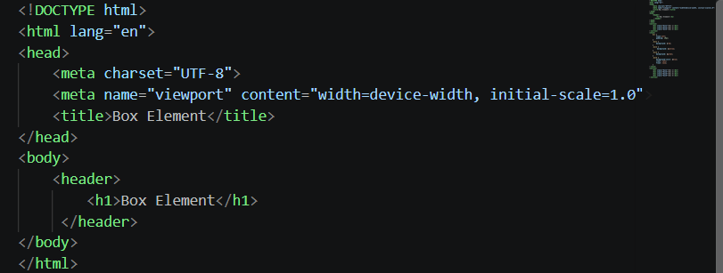

# Lab4— Praktikum 4: CSS Layout

Mata Kuliah: Pemrograman Web Nama: Alfi IFtihal Nurul Afiat NIM: 312510041 Kelas: I251D Program Studi: Teknik Informatika, Universitas Pelita Bangsa

# Tujuan Praktikum
Memahami struktur dasar pembuatan layout.
Memahami konsep box element.
Memahami CSS Floating.
Memahami HTML5 Semantic Element.
Membuat layout web sederhana.
# Struktur Folder
````
Lab4Web/
├── README.md
├── screenshots/
├── lab4_box/
│   └── lab4_box.html
└── lab4_layout/
    ├── home.html
    ├── about.html
    ├── kontak.html
    └── style.css
````
# Bagian 1 — Box Element dan CSS Float (```lab4_box/lab4_box.html```)
## 1.1 Membuat dokumen HTML dasar
Dibuat file lab4_box.html berisi kerangka HTML5 (````DOCTYPE, html, head, body````) dengan ````<header>```` yang berisi judul ````<h1>Box Element</h1>````. Tag ````meta viewport```` ditambahkan agar halaman menyesuaikan lebar layar perangkat.

## 1.2 Membuat box element
Di dalam ````<section>```` ditambahkan tiga tag ````div```` dengan class ````div1````, ````div2````, dan ````div3````. Semua elemen HTML pada dasarnya adalah sebuah kotak (box) yang terdiri dari margin, border, padding, dan content. Tanpa float, ````div```` bersifat block sehingga setiap ````div```` menempati satu baris penuh dan tersusun ke bawah.
````
html
<section>
    <div class="div1">Div 1</div>
    <div class="div2">Div 2</div>
    <div class="div3">Div 3</div>
</section>
````
## 1.3 CSS Float

Pada ````<style>```` ditambahkan ````float: left```` untuk semua ````div````, serta ````padding:10px```` dan warna latar berbeda untuk tiap class.
css
````
div {
    float: left;
    padding: 10px;
}
.div1 { background: red; }
.div2 { background: yellow; }
.div3 { background: green; }
````
Dengan ````float: left````, elemen "mengambang" ke kiri sehingga ketiga div tersusun mendatar dan lebarnya hanya sebesar isinya (bukan lagi satu baris penuh).
.png)
## 1.4 Clearfix (property clear)
Ditambahkan ````div4```` setelah ````div3````. Agar ````div4```` tidak ikut mengambang di samping ````div3````, digunakan property ````clear````.
````
css
.div4 {
    background-color: blue;
    clear: left;
    float: none;
}
````
````clear: left```` membuat ````div4```` turun ke bawah elemen yang float ke kiri, sehingga tampil pada baris baru dengan lebar penuh.
